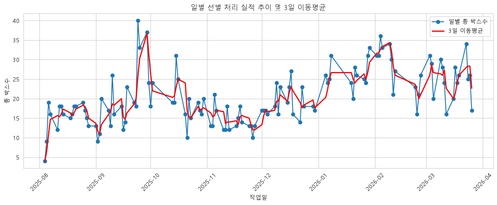
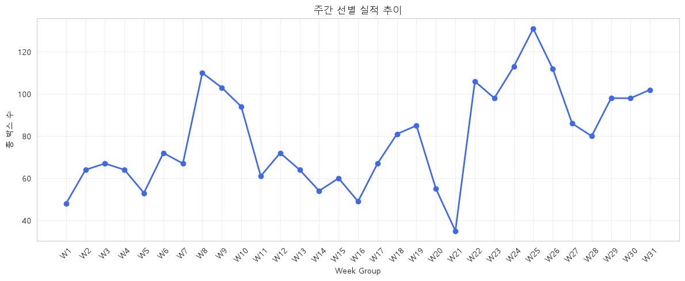
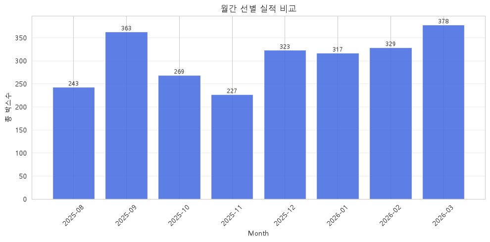

# T기업 8개월간 외주 선별 실적 트렌드 분석 리포트

## 1. 분석 주제 및 선정 이유

- T기업에서 외관 불량품에 대해서 외주 선별을 운용하기 시작한 2025년 8월부터, 약 8개월이 경과한 시점 
- 실적 흐름에서 “추세 변화가 있었는지”와 "처리 규모"를 데이터로 확인해보고자 함.

## 2. 분석 질문 (3개 이상)

1. 전체 기간 동안 일별 처리 실적은 어떤 추세를 보이는가?
2. 주간 단위로 묶으면 처리 실적의 추세에 변화가 있는가?
3. 월별 처리 실적 규모는 어떻게 차이 나는가?

## 3. 데이터 설명

- 내용: 선별 실시 실적 데이터 (RAW_data.xlsx)
- 출처: 협조를 통해 제공 받은 기업 내부 자료를 익명화 및 전처리하여 사용
- 기간: 2025-08 ~ 2026-03
- 데이터 수: 약 421ea (Lot 단위 작업일 구분)
- 칼럼 구성: 
    - 구분(N월 N주차)
    - 반(오전/오후)
    - 작업일(YY.MM.DD)
    - 품종*
    - Lot 코드*
    - 불량 유형*
    - 처리 수량(BOX)

## 4. 데이터 전처리

원본 데이터를 아래의 기준에 따라 과제 제출용으로 정제하여, 분석 가능한 형태의 단일 테이블로 구성하였다. 

1. 익명화
    - 품종 → 실제 품종명 대신 코드화하여 표기
        - `A`, `B`, `C`, `D`, `E`, `F`, `G`, `H`
    - 불량 유형 → 세부 항목을 대분류로 재분류
        - `타흔`, `홀 이상`, `표면 이상`, `복합 불량`
    - Lot 코드. →  실제 넘버를 추측할 수 없도록 코드화

2. 결측치 및 이상치 처리
    - 본 데이터는 매주 월~목에만 운영된 작업 기록이므로, 금·토·일 및 비정기 휴일의 데이터 부재는 결측이 아닌 비수집 자료로 판단했다.
    - 동일한 작업일, 반, 품종, 불량 유형, 처리 수량이 같더라도 Lot 코드가 다르면 서로 다른 작업 기록으로 간주하였다.
        - 원본 데이터는 Lot 단위로 기록되어 있으나, 최종 시계열 분석은 작업일 기준으로 재집계하여 수행
    - **처리 기준** : 
        - 결측치/이상치 발생 시, 먼저 원본 파일을 재확인한다. 
            - 실제 결측/이상의 경우에는, 해당 데이터를 배제하고 임의의 보정은 수행하지 않는다.  
            - 실제 결측/이상이 아니라면, 원인을 추적하여 수정한다. (예: 원인/병합 키의 형식 불일치 - 액션/정규화 후 분석 대상 데이터에 재병합)

## 5. 분석 결과 및 시각화

- ### [분석1] 일별 처리 실적 및 3일 이동평균
    - 기법: 전체 통계 및 **이동평균** / 꺾은선 그래프
    - 목적: 전체 기간의 실적 추이 파악, 노이즈 저감
    - 

- ### [분석2] 주간 선별 처리 실적
    - 기법: 구간별 통계 / 꺾은선 그래프
    - 목적: 일별 변동을 줄인 전체 실적 추이 확인
    - 

- ### [분석3] 월간 실적 비교
    - 기법: 구간별 통계 / 막대그래프
    - 목적: 월 단위 실적 처리 규모 비교
    - 

## 6. 인사이트(3개 이상)

### 인사이트 1. 전체적으로 후반부로 갈수록 처리 실적 수준이 높아지는 흐름이 나타났다.
- 관찰(Fact)
    - 일별 이동평균은 25년 10월 중순 ~ 11월 말에는 대체로 **10박스대 중반20박스 초반** 수준에 머물렀다.
    - 이후 2025년 12월부터 다시 상승하여, 2026년 1월 말~2월 초에는 30박스 안팎의 높은 수준에 도달했다.
    - 월별 집계에서도 **26년 1월(317), 2월(329), 3월(378)**은 모두 300박스 이상으로, 전반적으로 후반부 실적이 더 높았다.
- 원인(Why)
    - 가능한 가설 1: 시간 경과에 따라 작업 운영이 점차 안정화되면서 일별 처리량이 높아졌을 수 있다.
    - 가능한 가설 2: 후반부에는 실제 처리 대상 물량 자체가 증가했을 가능성도 있다.
    - 다만 현재 데이터만으로는 운영 효율 향상인지, 투입 물량 증가인지 구분하기 어렵다.
- 행동(Action)
    - 월별 총량뿐 아니라 작업일 수로 보정한 1일 평균 처리량을 함께 비교한다.
    - 인원수 대비 처리량을 계산해, 단순 물량 증가와 생산성 향상을 구분해본다.
    - 후반부 상승이 특정 기간의 집중 처리 때문인지 확인하기 위해 고실적 일자의 분포를 추가로 점검한다.

### 인사이트 2. 주간 실적은 상승 추세 속에서도 단기 변동성이 크게 나타났다.
- 관찰(Fact)
    - 주간 실적은 전체적으로 35~130박스 수준에서 크게 변동했다.
    - 최저 구간은 W21(1월 2주차), 최고 구간은 **W25(2월 2주차)**였다. 
    - 특히 W21(1월 2주차) → W22(1월 3주차) 구간에서는 한주만에 실적이 급격히 반등하는 모습이 확인된다.
    - 또한 초기 구간(W1~W7)보다 **후반 구간(W22 이후)**의 실적 수준이 상대적으로 더 높다.
- 원인(Why)
    - 가능한 가설 1: 주별 실적 차이는 실제 작업 효율 차이뿐 아니라 주차별 작업일 수 차이의 영향을 받았을 수 있다.
    - 가능한 가설 2: 특정 주에 물량이 집중되거나, 일시적으로 낮은 실적 주간이 발생하면서 변동 폭이 커졌을 수 있다.
    - 매주 월~목 운영 구조이므로, 비정기 휴일이나 일부 작업일 누락이 있으면 주간 총량이 크게 달라질 수 있다. 
    - 특히 1월 2주차에 급감했던 부분은, 연초 설연휴 포함으로 인한 작업일 누락이 있었을 것으로 예상된다.  
- 행동(Action)
    - 주간 총량만 보지 말고 주간 작업일 수, 1일 평균 처리량을 함께 비교한다.
    - 급변 구간(W21, W22, W25)에 대해서는 해당 주의 일별 실적 분해를 통해 특정 하루 이벤트 유무를 확인한다.
    - 이후 보고서에서는 “주간 총량의 등락”과 “실제 작업 강도 변화”를 구분해서 해석한다.

### 인사이트 3. 월별 실적은 2025년 11월 저점 이후 회복되어 2026년 3월에 최고치를 기록했다.
- 관찰(Fact)
    - 월별 실적은 25년 11월이 227박스로 가장 낮았고, 2026년 3월이 378박스로 가장 높았다.
    - 2025년에는 **9월(363)**과 **12월(323)**를 제외하면 300박스 이상을 달성하지 못했다.
    - 반면 2026년에는 1~3월 모두 300박스 이상을 기록하여, 이전보다 높은 실적 수준이 비교적 지속되었다.

- 원인(Why)
    - 가능한 가설 1: 11월은 일별 이동평균이 낮은 구간과 맞물려 있어, 실제 월간 처리 규모 자체가 줄어든 시기였을 수 있다.
    - 가능한 가설 2: 12월 이후에는 저점 이후 회복 국면에 들어서며, 높은 실적 구간이 보다 자주 나타났을 가능성이 있다.
    - 다만 월별 총량은 월별 작업일 수 차이의 영향을 받을 수 있으므로, 총량만으로 성과를 단정하기는 어렵다.
- 행동(Action)
    - 월별 총량과 함께 월별 작업일 수, 일평균 처리량을 병행 제시한다.
    - 저점(11월)과 고점(3월)의 차이가 작업 강도 차이인지, 단순히 가동일 수 차이인지 추가 검토한다.
    - 필요하다면 월별 박스 수를 작업일 기준으로 정규화하여 재비교한다.

## 7. 결론 및 한계점

- 결론: 장기적으로는 후반부 실적 수준이 높아졌다. 
    - 단,주간 단위 변동성이 커서, 총량만으로 해석하면 왜곡될 수 있다. 
    - 작업일 수나 인원수 데이터를 활용하여 보정한 추가 비교분석이 필요하다.

- 한계점: 본 데이터는 구간별 통계 분석에는 적합하지만, 다른 범주의 분석으로 확장함에 있어서 한계가 있었다.
    - 품종별 누적 처리율 분석의 경우, 수집 마감 시점(2026년 3월)의 값이 최종 목표치(100%)를 의미한다고 보기 어려워 해석의 유의미성이 낮다.
    - 불량유형 분석의 경우, 데이터에 포함된 불량이 실제 전체 불량이 아니라 선별 공정에 투입된 불량 기준이므로, 전체 불량 구조를 설명하는 데 한계가 있다.